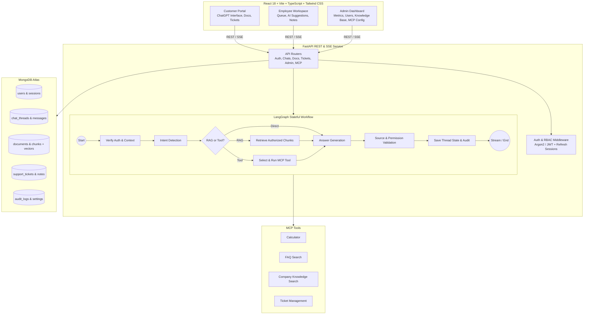

# AI Customer Support Platform (MCA Major Project)

[](https://www.python.org/)
[](https://fastapi.tiangolo.com/)
[](https://www.langchain.com/)
[](https://langchain-ai.github.io/langgraph/)
[](https://modelcontextprotocol.io/)
[](https://react.dev/)
[](https://tailwindcss.com/)
[](https://www.mongodb.com/atlas)

A modern, production-grade, ChatGPT-like customer support web application built with **FastAPI**, **LangChain**, **LangGraph**, **Model Context Protocol (MCP)**, **Retrieval-Augmented Generation (RAG)**, and **MongoDB Atlas Vector Search**.

---

## 🌟 Key Features

1. **ChatGPT-like Customer Experience**:
   - Multi-turn conversation history with persistent memory and thread resume.
   - Real-time Server-Sent Events (SSE) streaming answers with typing effect.
   - Rich Markdown formatting with syntax highlighting and one-click code copy.
   - Verified PDF page citations with document snippets and relevance scores.
   - Multilingual support switch (English, Hindi, Marathi).
   - Thumbs up/down response feedback and conversation export (Markdown/JSON).

2. **Stateful LangGraph AI Workflow**:
   - Directed acyclic graph routing: Intent Detection → RAG Retrieval → MCP Tool Selection → Execution → Response Generation → Source Grounding & Citation Validation → State Checkpoint Persistence.
   - Safeguards against hallucination and prompt injection attacks in PDF uploads.

3. **Model Context Protocol (MCP) Integration**:
   - Protocol-compliant MCP tool client and registry.
   - Ready-to-use tools: Safe Calculator, FAQ Search, Company Knowledge Search, Ticket Lookup, and Ticket Creation.
   - Strict role-based execution authorization and audit logging.

4. **Multi-Role Portals & Strict Data Isolation**:
   - **Customer Portal**: Chat assistant, uploaded document management, and ticket escalation.
   - **Employee Workspace**: Assigned customer queue, ticket priority/status management, AI-generated reply suggestions, and private internal notes.
   - **Admin Dashboard**: Analytics charts (Recharts), user and role management, company knowledge base CRUD, security audit trail, and AI model parameters.

5. **MongoDB Atlas Vector Search**:
   - Native Atlas vector indexing pipeline with resilient offline fallback for local evaluation.

---

## 🏗️ System Architecture



---

## 🚀 Quick Start Guide (Windows / Linux / macOS)

### Prerequisites
- **Python 3.12+**
- **Node.js 18+ & npm**
- **MongoDB Atlas** account (or local MongoDB / automatic fallback)

---

### Step 1: Clone and Configure Environment

```powershell
# Navigate to project directory
cd "e:\OPENAI VIBE CODE"

# Configure backend environment
cd backend
cp .env.example .env
```

Edit `backend/.env` with your settings (optional OpenRouter API key):
```env
MONGODB_URI="mongodb+srv://<username>:<password>@cluster0.mongodb.net/?retryWrites=true&w=majority"
MONGODB_DATABASE="ai_support_platform"
OPENROUTER_API_KEY="your-openrouter-key"
```

---

### Step 2: Backend Setup & Execution

```powershell
cd backend

# Create and activate Python virtual environment
python -m venv venv
.\venv\Scripts\Activate.ps1

# Install dependencies
pip install -r requirements.txt

# Start FastAPI server
python -m uvicorn app.main:app --host 0.0.0.0 --port 8000 --reload
```
Backend API will be running at: **http://localhost:8000**
Interactive Swagger Documentation: **http://localhost:8000/docs**

---

### Step 3: Frontend Setup & Execution

Open a new terminal window:
```powershell
cd frontend

# Install npm packages
npm install

# Start Vite development server
npm run dev
```
Frontend will be running at: **http://localhost:5173**

---

## 🔑 Default Accounts (Auto-Provisioned)

The platform automatically seeds an administrator account upon initial startup if none exists:

| Role | Email | Password |
|---|---|---|
| **Admin** | `admin@aisupport.com` | `AdminSecurePassword123!` |
| **Employee** | Register via `/signup` (select "Support Employee") | User chosen |
| **Customer** | Register via `/signup` (select "Customer") | User chosen |

*Quick login buttons are available directly on the login page for instant project evaluation.*

---

## 🗄️ MongoDB Atlas Vector Search Index Configuration

To enable hardware-accelerated vector search in MongoDB Atlas:
1. Open your **MongoDB Atlas** project and navigate to **Atlas Search & Vector Search**.
2. Select your collection: `ai_support_platform.document_chunks`.
3. Create a **Vector Search Index** named `vector_index` with the following JSON configuration:

```json
{
  "fields": [
    {
      "type": "vector",
      "path": "embedding",
      "numDimensions": 384,
      "similarity": "cosine"
    },
    {
      "type": "filter",
      "path": "user_id"
    },
    {
      "type": "filter",
      "path": "scope"
    },
    {
      "type": "filter",
      "path": "document_id"
    }
  ]
}
```

*Note: If no Atlas vector index is found, the application automatically computes in-database cosine similarity so all RAG queries function seamlessly.*

---

## 🐳 Docker Deployment

To spin up the full stack (MongoDB + FastAPI + React + Nginx) with a single command:

```bash
docker-compose up --build -d
```
- Web Application: **http://localhost:5173**
- Backend API Docs: **http://localhost:8000/docs**

---

## 🧪 Running Automated Tests

Run the test suite covering authentication, RAG chunking, embeddings, MCP tools, and LangGraph workflow:

```powershell
cd backend
pytest -v
```

---

## 📄 License & Academic Note
Created for MCA Major Project submission. Built adhering strictly to modern software engineering, defensive security, and scalable distributed AI agent principles.
